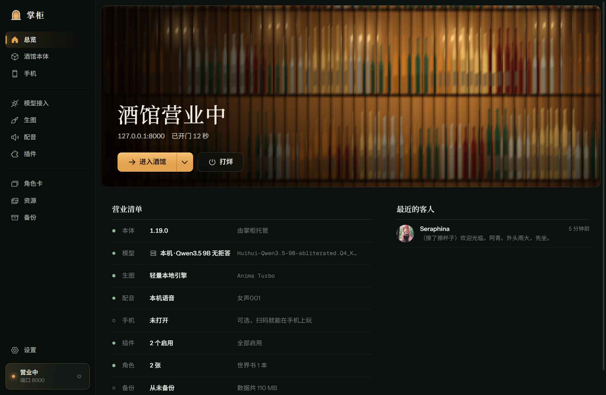
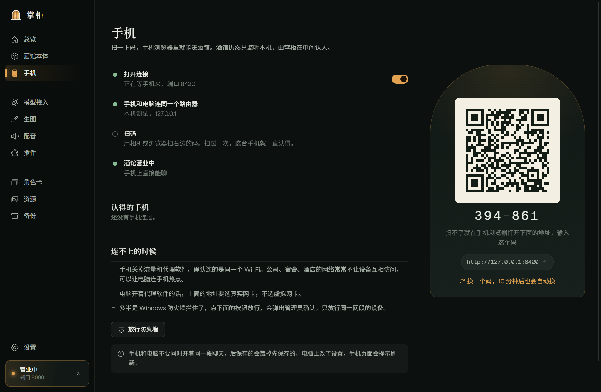
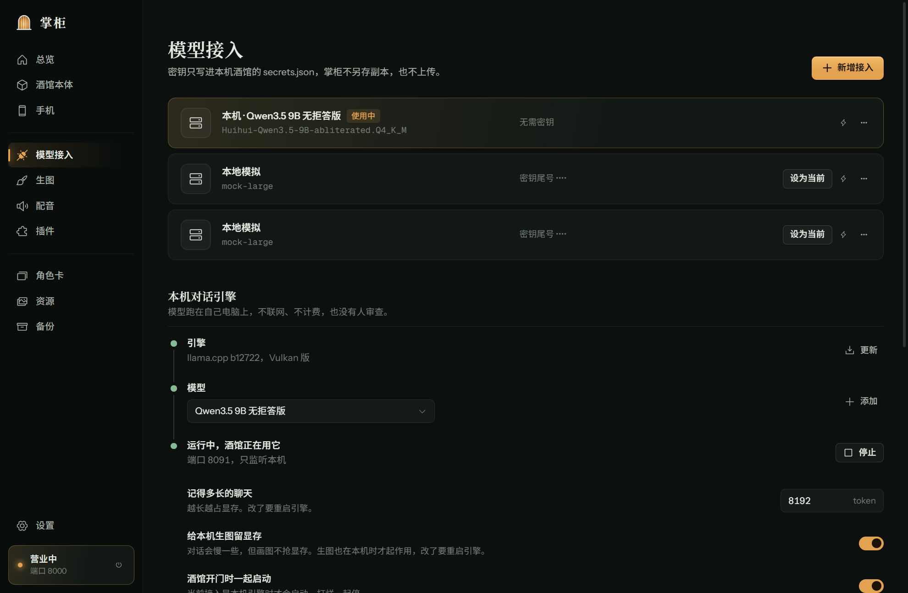
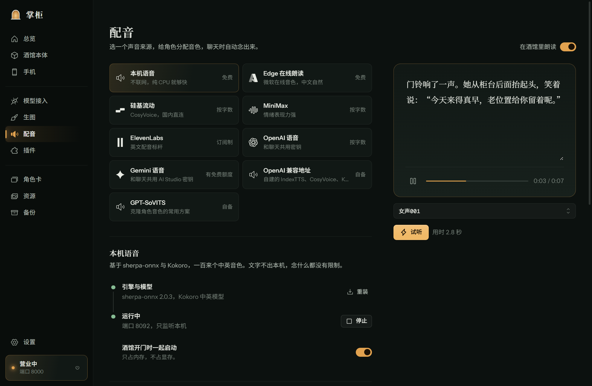
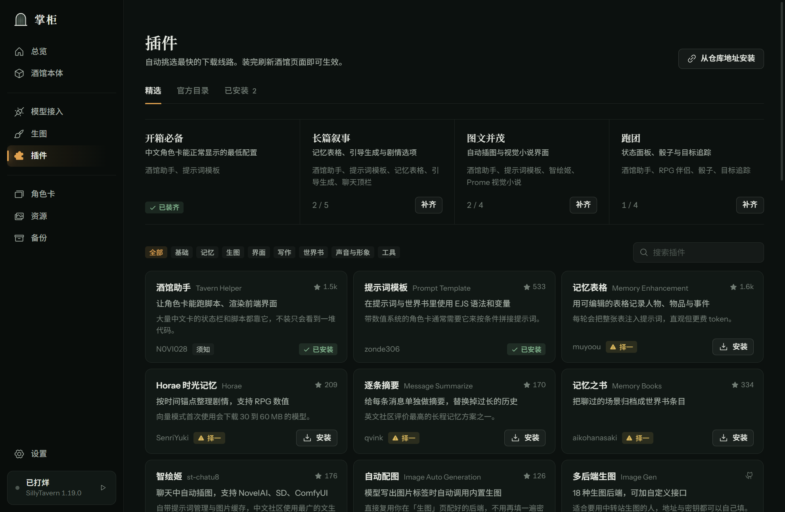
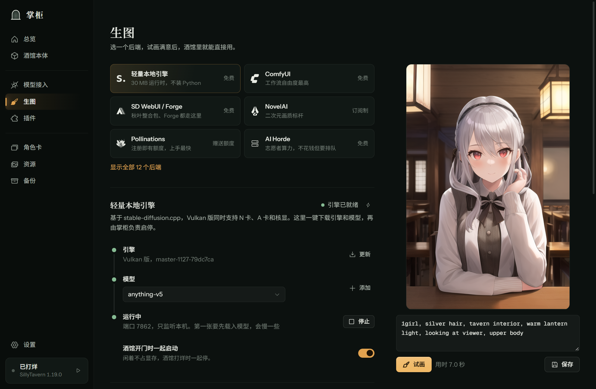
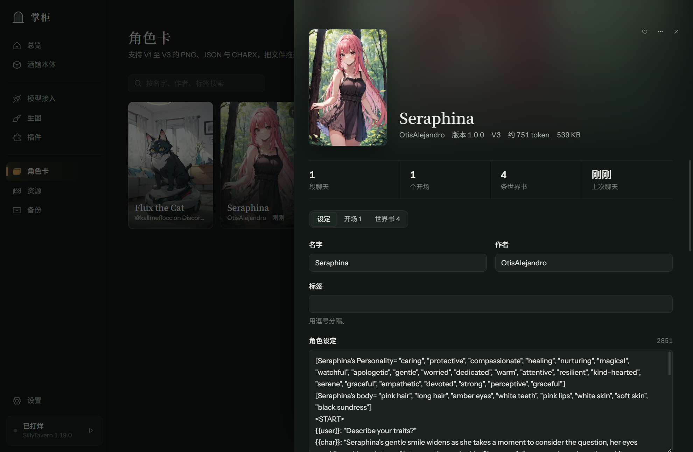
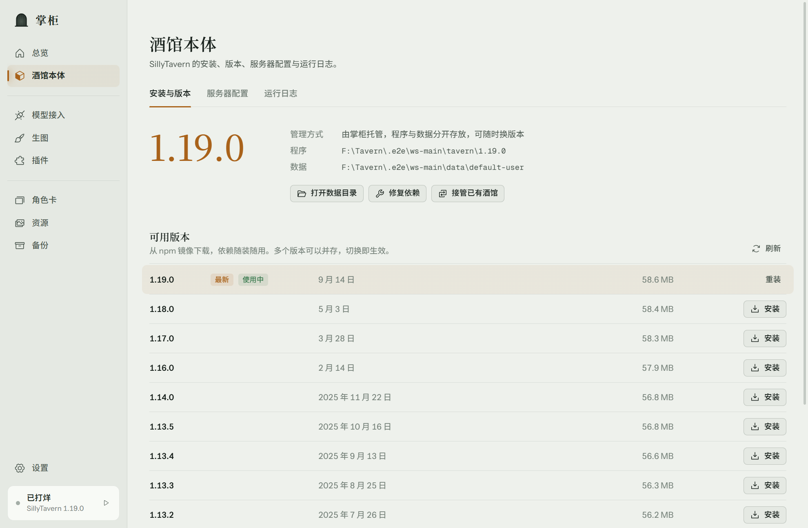

# 掌柜

SillyTavern（酒馆）的一键部署与管理工具。装本体、接模型、配生图、配音、视频、装插件、管角色卡，手机扫码就能玩，都在一个窗口里。



## 能做什么

| | |
|---|---|
| **一键配置** | 选位置、选模型、选插件，之后全自动。没装过 Node 和 Git 的电脑也能用，缺什么下载什么 |
| **酒馆本体** | 走 npm 镜像安装，多版本并存、随时切换；也可以接管你已有的酒馆目录。表单或 YAML 改 `config.yaml`，保留注释 |
| **手机** | 扫码配对，手机浏览器直接进酒馆。酒馆仍只监听本机，由掌柜在局域网上认人转发 |
| **模型接入** | 二十多家服务商（国内直连、海外、聚合、本机、自定义地址）。测试密钥、读取模型列表、一键切换 |
| **本机对话引擎** | 一键装 llama.cpp 和开放模型，不联网、不计费。随酒馆一起启停 |
| **生图与视频** | 12 种后端，含本机轻量引擎、ComfyUI、SD WebUI、NovelAI 等。在应用里试画，满意后酒馆直接可用；ComfyUI 可下载 Wan 模型出短片、让聊天里的图动起来；角色外貌锁定、角色 LoRA，同一个角色每张都长一样 |
| **配音** | 本机语音（一百来个中英音色）、Edge、硅基流动、MiniMax、ElevenLabs 等，给每个角色分配音色 |
| **插件** | 36 款精选加官方目录，自动挑最快线路，提示功能冲突，检查更新 |
| **角色卡** | V1 至 V3 的 PNG、JSON、CHARX。拖拽导入、编辑、换立绘、提取世界书、批量删除；收藏夹里的卡要先取消收藏才能删，在酒馆里删也一样 |
| **资源与备份** | 世界书、对话预设、主题、背景、ComfyUI 工作流；整包备份与恢复，恢复前自动再备一份 |

<details>
<summary>更多截图</summary>









</details>

## 使用

到 [Release 页](https://github.com/EdwinNull/innkeeper/releases/latest) 下载：

| 系统 | 文件 |
| --- | --- |
| Windows 10 / 11（64 位） | `Innkeeper-<版本>-setup.exe` |
| Mac，Apple 芯片（M1 及以后） | `Innkeeper-<版本>-mac-arm64.dmg` |
| Mac，Intel 芯片 | `Innkeeper-<版本>-mac-x64.dmg` |

**Windows**：安装包没有代码签名，首次运行时会提示「未知发布者」，点「更多信息 → 仍要运行」。

**Mac**：没有苹果开发者证书，也没做公证。把「掌柜」拖进「应用程序」后第一次打开会提示无法验证开发者：点「完成」，到「系统设置 → 隐私与安全性」最下面点「仍要打开」。或者在终端里运行一次 `xattr -cr /Applications/掌柜.app`。

### Mac 版

和 Windows 版共用一套代码，下面这些不一样：

- 窗口用系统的红绿灯按钮；关窗口只是收起，酒馆继续营业，点程序坞图标回来，⌘Q 才退出并让酒馆打烊。
- 从访达打开的应用拿不到终端里的 PATH，掌柜会自己补上 Homebrew 的目录，系统里有 Node、Git 照样能用。系统自带的 `/usr/bin/git` 在没装 Xcode 命令行工具时只是个弹安装框的壳，掌柜认得出来，改用内置的 Git。
- 本机对话引擎：Apple 芯片装 Metal 版（要 macOS 13.3 以上），Intel 芯片装 CPU 版。Apple 芯片显存和内存是同一块，按内存的三分之二左右算可用显存。
- 本机语音：sherpa-onnx 有 Mac 版，Apple 芯片和 Intel 都能装。
- 轻量生图引擎：上游的 Mac 版是在 macOS 26 上编的，低于 26 的系统会直接提示，不去下载。
- ComfyUI 便携包、GPT-SoVITS 整合包都只有 Windows 版：Mac 上这两个按钮会说明原因，不会去下几个 GB 的 Windows 包。ComfyUI 可以自己装好源码版（带 venv）后绑定目录。
- 「放行防火墙」按钮只在 Windows 上有；Mac 开了防火墙的话，第一次打开手机连接时系统会问是否允许传入连接。

### 手机

在「手机」页打开连接，手机和电脑连同一个路由器，扫码即可。第一次打开时 Windows 会问是否允许访问网络，选允许；之前点过取消的，用页面上的「放行防火墙」。Mac 上系统会问是否允许传入连接，选允许。

- 只有配对过的手机能进。二维码与 6 位配对码十分钟一换，用过即失效，连错五次要等五分钟。
- 只接受内网地址的连接。走的是 HTTP，同一网络里的人理论上能截获内容，不要在公共 Wi-Fi 上开。
- 电脑上改了设置，手机的旧页面会提示刷新，并拦住它把新设置盖掉。

### 成人内容

默认不列。在「设置 → 内容」里确认年满 18 岁后，会列出不拒答的本机模型、对成人虚构内容友好的平台，以及成人向的画图模型；生图多一个分级选项。

- 平台的态度依据各家官网与条款整理，没有明确写的不收。掌柜不提供绕过其他平台审核的提示词，那样容易封号。真正不受限制的是跑在自己电脑上的模型。
- 成人档的负面提示词固定包含未成年相关的词，去掉会自动补回；试画时描述里提到未成年人会直接拒绝。

### 本机对话

「模型接入」页里的「本机对话引擎」，依次点安装、添加模型、启动，酒馆会自动切过去。实测 RTX 4060 Laptop 8 GB、Qwen3.5 9B（Q4）：载入约 10 秒，生成约 28 token/秒。

对话和生图都在本机时，默认给生图留出显存：对话降到约 10 token/秒，画图不受影响。不需要就在页面里关掉。

### 本机语音

纯 CPU。实测 i7-14650HX 合成速度约为实时的 3.5 倍（8 秒的话合成 2 秒多）。文字由酒馆服务端转发，手机上也能出声。

### 克隆声线

配音页选「本机语音」后有「克隆声线」：录一段或导入一段三到十秒的声音（五秒左右最好），写下一字不差的原文，勾选「这是我自己的声音，或已得到本人同意」，它就出现在音色列表里，叫「克隆·名字」，可以分给角色。

声线由本机的 GPT-SoVITS v5（turbo 档）来念，掌柜一键安装官方 Windows 整合包：约 10.9 GB，走 ModelScope 国内线路，核对官方 SHA-256，解压后约 18 GB；已有整合包可以直接绑定。50 系显卡会自动选单独打的包。它只监听本机，酒馆不直接连它，由掌柜的本机语音服务转过去，所以酒馆的配音设置不用改，手机上也能出声。跟着本机语音、跟着酒馆一起启停。

实测（RTX 4060 Laptop 8 GB）：启动约 20 秒，约占 3.5 GB 显存；预热后合成耗时约为语音时长的 0.4 到 1 倍，跟得上说话。和本机对话模型、本机画图同开时显存会紧，建议有一边用云端。

先试过 sherpa-onnx 自带的 ZipVoice（纯 CPU、163 MB），实听有明显的电子音、没有气口，没有采用。

### 视频

需要 ComfyUI。在生图页的 ComfyUI 面板里下载视频模型，工作流会自动放好。两种拍法，各有一个聊天框按钮：

- **拍这一幕**：按最后一条消息从头拍（Wan 2.1 1.3B 或 Wan 2.2 5B）。对话模型先把这一幕写成一段带动作和运镜的英文描述，再交给视频模型；拍完自动换回画图工作流。
- **动起来**：让聊天里最后一张图动起来（Wan 2.1 Fun InP 1.3B 或 Wan 2.2 5B）。人物、衣服、场景都来自那张图，对话模型只写怎么动，所以和配图是同一个人。掌柜会在 ComfyUI 里放一个只用它自带依赖的小节点，把聊天里的图交给工作流；第一次用要重启一次 ComfyUI，生图页会提示。

每个模型可以选横竖、时长，以及出 **视频**（mp4，带播放条）还是 **动图**（循环播放的 WebP，聊天里和图片一样显示，手机上也能看）。「动起来」默认出两秒动图。开着自动配图时，还可以设成每隔几张把配图接着做成动图。

成人内容：对话模型拒写动作描述时，「动起来」改用通用的动作加那张图的提示词，「拍这一幕」改用最后一条消息。打开成人内容后，视频的负面提示词带上未成年相关的词，写出来的动作描述里提到未成年人就不拍。Wan 底模对露骨动作认识有限，可以把对应版本的 LoRA 放进 `imagegen/parts/loras`，在模型下面选上，强度 0.6、0.8、1 三档。

实测 RTX 4060 Laptop 8 GB：Wan 2.1 1.3B 拍这一幕 480P，1 秒约 80 秒，2 秒约 200 秒；Fun InP 动起来 512×752，1 秒约 70 秒，2 秒约 150 秒，两秒动图约 3 MB。

### 本机生图

在「生图」里选「轻量本地引擎」，依次点安装、添加模型、试画。引擎约 30 MB，SD 1.5 模型约 2 GB，下载时会给 ModelScope、hf-mirror、Hugging Face 测速并选最快的，下完核对校验值。

在酒馆里点输入框旁的魔棒，选「生成图片」，或输入 `/imagine` 加描述。酒馆的「交互模式」只认英文句式，中文不会触发。

参考速度：RTX 4060 Laptop 8 GB，Anything V5，512×768，20 步，约 7 秒一张；Anima Turbo，832×1216，10 步，约 15 秒一张。第一张要从硬盘载入模型，冷启动约 30 秒。显存不足时引擎会自动把部分权重放进内存，能出图但慢几倍。

ComfyUI 也能一键下载（约 2 GB，解压后约 4.3 GB），轻量引擎下载的模型两边共用。重装会保留模型、节点、工作流和出图。

SDXL 二次元模型（WAI Illustrious v17，832×1216，26 步）：ComfyUI 约 22 秒一张，轻量引擎约 32 秒；画 SDXL 建议用 ComfyUI。

### 聊天里配图

酒馆会把聊天上下文交给你接入的对话模型，让它把这一幕写成画图提示词，再交给生图后端。魔棒菜单里的「最后一条消息」「整个故事」「角色」「背景」，以及 `/imagine last`、`/imagine scene` 走的都是这条路。掌柜在生图页的「聊天里配图」里补了几样：

- **提示词写法**：酒馆出厂的说明让模型写英文短语，还要求「至少两个人」，不适合认 Danbooru 标签的二次元模型。掌柜按画风换成两套说明：WAI、Illustrious、Anything 这类写标签（先写 `1girl, solo` 这样的人数），FLUX、Z-Image 和各家云端模型写一段英文描述。你在酒馆里改过的那几条不会被覆盖。
- **写提示词用：当前对话模型 / 本机模型**：主聊天用付费接口（Gemini、中转）时，每画一张图、拍一段短片都要多调用一次。选「本机模型」后，这一步改由掌柜的本机对话引擎（llama.cpp）来写，主聊天照旧用原来的接入。原理是掌柜的扩展在酒馆发出「写提示词」那次后台请求前，把它换成发给本机引擎的精简请求：只带角色设定、用户设定、最近八条聊天和画图说明，不带主预设，所以小模型也写得动、写得快。魔棒菜单、`/imagine`、画这一幕、自动配图和拍短片都算。酒馆开门时引擎跟着启动（模型页里关掉「酒馆开门时一起启动」时除外），但不会设成酒馆的当前接入。本机引擎只用来写提示词时，默认写完约 5 秒就把模型移出显存留给生图，下次写多等约 5 秒载入；不想等可以在生图页关掉「写完就让出显存」。引擎没装、没模型或没在运行时，这次仍用当前对话模型写，酒馆里会弹提示。经酒馆后端转发，手机上打开酒馆也一样。当前接入是本机引擎时两种选法效果一样。
- **「画这一幕」按钮**：放在聊天框上，任何后端都能用。ComfyUI 下会先切回画图工作流。
- **每条回复后自动配一张图**：靠掌柜放进酒馆的一个小扩展（`extensions/innkeeper-scene`）。不用快捷回复的「AI 回复后执行」，是因为配图本身也算一条角色消息，会再次触发，一直画下去。配图不进对话上下文。
- **角色长相**：在「角色卡」里打开角色，「画图」页分两栏：「外貌」只写不会变的（发色、发型、瞳色、身材、特征），「常穿的衣服」单独写。可以手填，也可以让对话模型从设定里提取，提取出来会自动分好两栏；旧版本存的外貌里混着衣服，点「把外貌里的衣服挪过来」就能拆开。存在酒馆的生图设置里，不改卡片。设定是未成年人的角色不提取、不保存。
- **成人场面自己选模板**：打开成人内容、分级不是「全年龄」时，画这一幕、自动配图、拍短片和试画会看最近两句原文，对上了就套对应模板（暧昧、亲吻、更衣、内衣、裸体、入浴、自慰、双女、性交和几种体位、事后）。WAI、Illustrious、NoobAI 补 Danbooru 标签，Pony 改成下划线，写实模型补一句英文，Wan 图生只换动作句。日常句子不套。外貌仍以角色卡为准；写了全裸或性行为就不把常穿的衣服套回去。提到未成年人，或出现在校生、学生制服，不套模板。酒馆已经开着的话，重新打开一次才用新的扩展。
- **每张都是同一个人**：对话模型每张都会重新写发色、瞳色、身材，和外貌对不上时，两组词一起送进去就会一张一个样。掌柜的扩展在出图前以外貌为准：外貌写了 `silver hair`，模型写的 `white hair`、`blonde hair` 就去掉；发长、瞳色、肤色、胸围、发型、兽耳同理，`long brown hair` 这种连写的也认得。多人同框时分不清是谁的，不动。
- **衣服跟着剧情走**：「常穿的衣服」只在模型这一幕没写穿什么时才加；写了泳装、换装或 `nude`，就听这一幕的。只写了 `open shirt`、`skirt lift`、`no bra` 这类衣服状态时，照样是常穿那身。
- **角色 LoRA**：最稳的办法。外貌下面的「加入角色 LoRA」会写进 `<lora:文件名:0.8>`，记得把它的触发词也写进外貌。文件放在 `imagegen/parts/loras`，绑定的 ComfyUI 自己的 `models/loras` 也算。
  - 轻量引擎和 SD WebUI 本来就认这种写法。
  - ComfyUI 不认，掌柜在 ComfyUI 里放了一个读它的小节点（只用 ComfyUI 自带的依赖）。任何角色的外貌或通用前缀里写了 `<lora:…>`，就在原工作流旁边写一份 `掌柜_LoRA_` 开头的副本并切过去：节点从提示词里取出 LoRA 加载，再把去掉标签的提示词交给文本编码器，负面提示词也用加载过 LoRA 的编码器，和 SD WebUI 一致。和高清修复同开时是一份 `掌柜_高清_LoRA_` 副本。外貌里不再有 LoRA 就切回原工作流。只认正向提示词写成 `%prompt%` 的工作流，酒馆默认那份就是。
  - 写错文件名时，出图会报「找不到 LoRA：名字」。

写提示词的是你的对话模型，或上面选的本机模型。会拒答的云端模型在露骨场景下可能不肯写，本机的无拒答模型没有这个问题。小模型照着说明也会夹带画不出来的词（ethereal、caring expression），或者用错标签（white skin 会画成灰白皮肤），还会在前面加「Sure! Here are the tags:」、给标签编号、在后面补一句说明，掌柜的扩展会在出图前把这些清掉，并去掉前缀里已有的词，只清理模型写的，你自己用 `/imagine` 写的不动。

实测（本机 Qwen3.5 9B 加 ComfyUI、WAI v17、高清修复）：发出一句话到回复写完、自动配图出来约 110 秒。

### 高清修复

生图页「画面」里的开关。先按原尺寸出图，再放大 1.5 或 2 倍，用同一组提示词低强度重画一遍，线条、发丝和眼睛会细很多。第二遍的步数按重画力度折算（26 步、力度 0.4 走 11 步），和 SD WebUI 的做法一致。

- 轻量引擎：作为启动参数，酒馆发来的请求自动套用，改设置时引擎会自己重启。
- ComfyUI：掌柜在当前工作流旁边写一份 `掌柜_高清_` 开头的副本并切过去，原工作流不动；关掉时切回原来那份。只认「采样 → 解码 → 保存」这种常见结构，认不出时会提示。
- SD WebUI / Forge：打开酒馆自带的 Hires. fix，放大方式用 Lanczos。
- 云端服务不支持。

实测（RTX 4060 Laptop 8 GB，力度 0.4）：WAI v17 832×1216 放大 1.5 倍，ComfyUI 约 45 秒一张，轻量引擎约 65 秒；Anima Turbo 放大 1.5 倍约 30 秒；Anything V5 512×768 放大 1.5 倍约 17 秒，放大 2 倍约 26 秒。SDXL 放大 2 倍要两三分钟。

## 数据放在哪

托管模式下，所有东西都在你选的工作目录里，删掉文件夹即可完全清除：

```
工作目录/
├─ tavern/<版本>/     酒馆程序，可多个并存
├─ data/              角色、聊天、密钥、插件（换版本不影响）
├─ config.yaml        酒馆服务器配置
├─ runtime/           便携版 Node（系统没有时才下载）
├─ imagegen/          本机生图引擎、ComfyUI 与模型
├─ chat/              本机对话引擎与模型
├─ voice/             本机语音
├─ backups/           备份
└─ cache/             下载缓存，可随时删
```

掌柜自己的偏好存在 `%APPDATA%/掌柜`。接管模式下，数据留在原酒馆目录。

**密钥**只写进酒馆的 `secrets.json`（酒馆本身就是明文存放），掌柜不另存副本。备份包里含密钥，不要随意分享。

## 开发

需要 Node 22 以上。

```powershell
npm install
npm run dev        # 开发
npm test           # 单元测试
npm run typecheck
npm run dist       # 打 Windows 安装包，输出到 release/
npm run dist:mac   # 在 Mac 上打 dmg（Apple 芯片、Intel 各一个），ad-hoc 签名
npm run e2e        # 端到端测试，会真实下载并启动酒馆，约十分钟
node tests/e2e/platform.mjs      # 换平台先跑它：一键配置（强制便携版 Node）、三个本机引擎能装能跑；E2E_LIGHT=1 只看界面
node tests/e2e/local-image.mjs   # 本机生图，首次下载约 2.2 GB
node tests/e2e/local-llm.mjs     # 本机对话，首次下载约 5.7 GB
node tests/e2e/local-voice.mjs   # 本机语音，首次下载约 370 MB
node tests/e2e/comfy.mjs         # ComfyUI，首次下载约 2 GB；有视频模型时连视频一起测
node tests/e2e/hires.mjs         # 高清修复，要先跑过上面两项并下好 WAI Illustrious v17
node tests/e2e/voice-clone.mjs   # 克隆声线，要先装好本机语音和 GPT-SoVITS v5，别处的整合包用 GSV_DIR 指定
node tests/e2e/animate.mjs       # 让图动起来，要先跑过 comfy.mjs、下好 WAI v17 和 Wan 2.1 Fun InP；加 E2E_CHAT=1 再走一遍酒馆里的按钮
node tests/e2e/lora.mjs <文件>    # 角色 LoRA（ComfyUI），要先跑过 comfy.mjs 并下好 WAI v17；随便一个 SDXL LoRA 就行，同一个种子比较加与不加
```

### 发布

改好 `package.json` 里的版本号，推送同名标签（如 `v0.2.0`）。GitHub Actions 会在 Windows 上打 exe、在 Apple 芯片的 Mac 上打两个 dmg 并跑 `platform.mjs`，都通过后连同 `SHA256SUMS.txt` 发到 Release 页，说明取自 `.github/release-notes.md`。也可以在 Actions 页手动运行，只打包和检查、不发布。

### 热更新

改完代码不用重新打安装包、重新安装，直接换进已经装好的掌柜：

```powershell
npm run hot-update                        # 构建，换进 ./Innkeeper
npm run hot-update -- --dir "D:\掌柜"     # 装在别处时
npm run hot-update -- --launch            # 换好后打开掌柜
npm run hot-update -- --rollback          # 退回上一版
npm run hot-update -- --original          # 换回安装包装上的那一版
```

只换 `resources/app.asar`，主程序、界面和放进酒馆的扩展都在里面。装着的已经是这一版就不换。旧版留作 `app.asar.bak`，安装包装上的那一版留作 `app.asar.orig`。每次酒馆开门前，掌柜会把新版扩展写进酒馆。

文件被占着时换不了，脚本会列出是哪个程序开着它，并等它关掉（默认等 300 秒，`--wait 秒数` 可改）：

- 掌柜自己开着：从托盘图标右键退出。
- **Claude 桌面版、VS Code 这类 Electron 程序**：它们只要碰过 `.asar` 的路径，就会把它当压缩包一直开着，直到程序退出。掌柜装在它们打开的项目文件夹里（比如装在 `F:\Tavern\Innkeeper`）就会遇到。在单独的 PowerShell 窗口里运行热更新，然后彻底退出那个程序，换好后再打开。想以后不用这样，就把掌柜装到项目文件夹外面，热更新时用 `--dir` 指过去。

安装包开着「只从 asar 加载」、没开 asar 完整性校验，所以能这样换；以后若打开校验，只能重新打包。

```
src/
├─ shared/           类型、IPC 契约、服务商 / 生图 / 插件目录
├─ main/
│  ├─ core/          网络与镜像、下载、任务、进程、Git、运行时
│  ├─ tavern/        安装、进程、配置、密钥与设置、内嵌窗口
│  └─ features/      模型、本机对话、角色卡、插件、生图、视频、配音、手机连接、备份、一键配置
├─ preload/
└─ renderer/src/     React 界面
tests/               单元测试；tests/e2e/ 为端到端测试
```

### 几个设计决定

- **优先走 npm 而不是 GitHub。** SillyTavern 官方在 npm 上发包，国内镜像能跑满带宽；GitHub 作为后备，并对多条加速线路测速。
- **程序与数据分离。** 启动时用 `--configPath` 和 `--dataRoot` 指到工作目录，升级、回退只换程序目录。
- **改设置时先让酒馆窗口离开页面。** 酒馆前端会把整份设置留在内存里随时写回，直接改文件会被覆盖。掌柜自带的窗口会自动处理；浏览器里开着的页面需要手动刷新。
- **酒馆窗口与掌柜隔离。** 酒馆页面跑在独立会话里，拿不到任何本地接口。
- **不留孤儿进程。** 掌柜退出或崩溃，酒馆都会跟着走完清理流程再退出，生图引擎也一起结束。
- **镜像只管传输，不管信任。** 引擎、ComfyUI 和目录里的模型都核对 SHA-256，校验值来自 GitHub 官方接口或写死在目录里；Node 优先用 nodejs.org 的清单，酒馆核对 npm 的 integrity。只有两样没有官方校验值可对：npm 不可用时的 GitHub 后备包，以及插件。
- **引擎版本固定。** stable-diffusion.cpp 和 llama.cpp 一天会发好几版，首次安装用测过的那一版，之后由用户决定是否更新。
- **大文件多连接、多线路同时下。** 海外线路单条连接的速度相差十几倍。32 MB 以上的文件开六条连接，分给几条线路，慢的自动换，断了接着下，最后统一核对校验值。
- **不用可映射显存。** ggml 的 Vulkan 后端默认用 ReBAR 显存，Windows 在显存偏满时会把它挪去内存，同一张图能从 3 秒变成 88 秒。两个引擎启动时都设了 `GGML_VK_DISABLE_HOST_VISIBLE_VIDMEM=1`。
- **本机模型的消息格式。** 开源模型的模板大多要求系统提示在最前、一问一答交替，酒馆默认发的不是。接入本机引擎时把「提示词后处理」设为严格，换回云端时复原。
- **手机不碰酒馆的监听设置。** 酒馆只监听 127.0.0.1，掌柜另开一道门做配对和转发，酒馆看到的就是一次本机访问。

## 已知限制

- Windows 版只在 Windows 11、N 卡上验证过。A 卡、核显没有测。
- Mac 版在 GitHub Actions 的 Apple 芯片虚拟机上自动检查：dmg 装好能启动、一键配置走通、对话引擎和本机语音能装能跑。没有在真机上手动用过，Intel 版只确认了能打包，没有启动过。虚拟机没有 Metal 显卡，本机模型出字、出图的速度没有测。
- 实测过的模型：生图 Anything V5、Anima Turbo、WAI Illustrious v17；对话 Qwen3.5 9B 无拒答版；语音 Kokoro、GPT-SoVITS v5 turbo；视频 Wan 2.1 1.3B、Wan 2.1 Fun InP 1.3B。目录里其余模型只核对了校验值，没有跑过；Wan 2.2 5B 的「动起来」没有跑过。
- 角色 LoRA 在 ComfyUI 上用一个随机生成的测试 LoRA 实测过（同一个种子，权重 0 和不写逐像素一致，权重 1 明显不同），没有用社区里训练好的角色 LoRA 看过效果。轻量引擎的 `<lora:…>` 只确认了引擎带着 LoRA 目录能启动，没有实际加载过。视频 LoRA 只核对了工作流的接法。
- 手机连接用手机尺寸的无头浏览器在本机回环上测过，没有用真手机测。「放行防火墙」按钮没有实际点过。
- Edge 朗读插件、各家收费的配音与视频接口没有用真实账号测过。
- 「从设定提取」外貌只用 OpenAI 兼容接口实测过；Claude、Gemini 两种原生接口按文档写好，没有用真实账号测。
- 高清修复在 SD WebUI / Forge 上只用模拟服务核对过请求字段，没有接真的 WebUI 出图；Z-Image 开高清修复没有测过。
- ComfyUI 便携包靠系统自带的 `tar` 解压（Windows 11 23H2 起支持 7z），更旧的系统会改用已安装的 7-Zip。
- 酒馆助手默认会把上下文长度锁到 200 万，长聊费 token，可在它的设置里关闭。

掌柜以 MIT 许可发布，见 [LICENSE](LICENSE)。SillyTavern 由其社区开发，采用 AGPL-3.0 许可。掌柜是独立的管理工具，与官方无隶属关系。

本机语音的 MP3 编码使用 [lamejs](https://github.com/zhuker/lamejs)（LGPL-3.0），以独立文件随安装包分发，见 `resources/voice/`。
